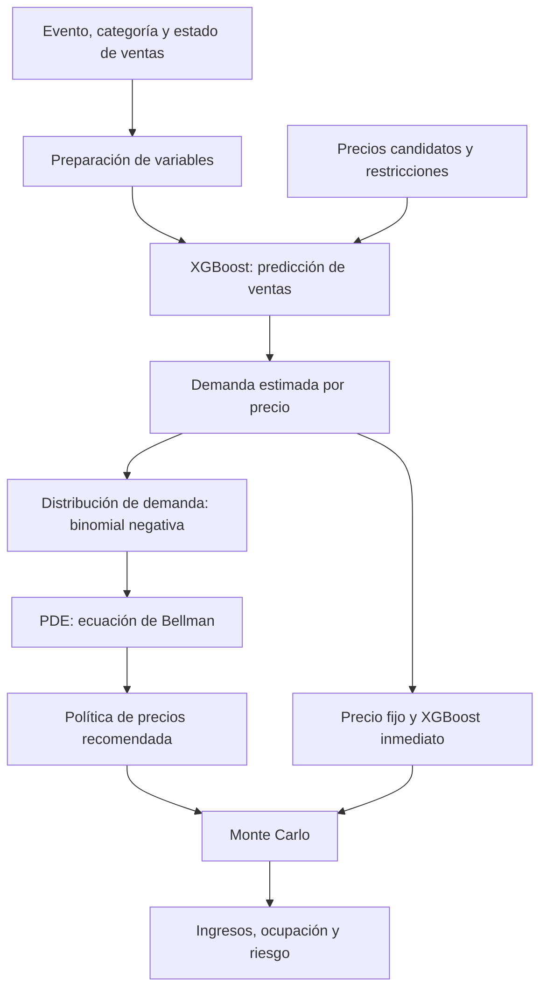

<div align="center">

# 🏟️ STADIUM IQ

### Smart Stadium Pricing

**Intelligent Demand Forecasting · Dynamic Ticket Pricing · Revenue Optimization**

Plataforma académica para predecir ventas de entradas, recomendar precios y comparar estrategias tarifarias en eventos deportivos.

<br>


<br>

[El proyecto](#-el-proyecto) · [Funcionalidades](#️-funcionalidades) · [Metodología](#-cómo-funciona) · [Resultados](#-resultados-experimentales) · [Instalación](#-instalación-y-ejecución) · [Limitaciones](#️-limitaciones)

</div>

---

## 💡 El proyecto

### ¿Cuál es el precio adecuado para una entrada deportiva?

Un precio demasiado bajo puede desaprovechar oportunidades de ingresos. Uno demasiado elevado puede reducir la demanda y dejar entradas sin vender. La decisión depende de la popularidad del evento, los días restantes, el inventario disponible, las categorías de entradas y las condiciones de cada deporte.

**STADIUM IQ** integra tres componentes complementarios:

1. **XGBoost:** predice las ventas del próximo período ante diferentes precios candidatos.
2. **Programación Dinámica Estocástica (PDE):** determina una política de precios considerando los ingresos inmediatos y las oportunidades de los días futuros.
3. **Monte Carlo:** compara políticas de precio fijo, optimización inmediata y XGBoost + PDE en múltiples escenarios de demanda.

El prototipo está orientado a cuatro deportes: **fútbol, baloncesto, tenis y running**.

> [!IMPORTANT]
> **Proyecto académico Mid-Term.** Los datos de entrenamiento y las simulaciones son sintéticos. Los resultados sirven para comprobar el funcionamiento interno y estudiar escenarios hipotéticos; **no constituyen una validación con ventas reales ni garantizan incrementos de ingresos en el mercado**.

---

## 📊 STADIUM IQ en cifras

| Dataset multideporte | Modelo predictivo | Evaluación actual XGBoost + PDE |
|:---:|:---:|:---:|
| **1.000 eventos** | **2 modos:** Direct y Rate | **8 casos**, dos por deporte |
| **4 deportes** | **800 / 200 eventos** train/test | **300 réplicas** por caso |
| **60.000 observaciones** | **MAE Rate: 6,964 entradas** | **7 de 8** casos con mayor ingreso medio PDE |

La evaluación histórica **V8.2**, desarrollada en una fase anterior, se documenta por separado más adelante. Sus resultados no deben confundirse con la evaluación Monte Carlo de tres políticas.

### Deportes compatibles

| ⚽ Fútbol | 🏀 Baloncesto | 🎾 Tenis | 🏃 Running |
|:---:|:---:|:---:|:---:|
| Partidos y estadios | Pabellones y competiciones | Torneos y sesiones | Carreras e inscripciones |

---

## 🖥️ Funcionalidades

La plataforma ofrece las siguientes secciones desde el menú lateral:

### 01 — Inicio

Presentación del proyecto y accesos al simulador, el comparador y el historial de eventos.

### 02 — Simulador multideporte

- Configuración del deporte, categoría y características del evento.
- Selección de días restantes e inventario disponible.
- Predicción de ventas de XGBoost para precios candidatos.
- **Recomendación principal mediante XGBoost + PDE**, orientada a maximizar los ingresos esperados del horizonte restante.
- Visualización de ventas previstas para el próximo día e ingresos esperados.

> La recomendación principal de la PDE no debe confundirse con el precio de la **estrategia XGBoost inmediata**, que solo optimiza el siguiente período. Con un único día restante, ambos criterios pueden coincidir.

### 03 — Historial de eventos

Consulta de los eventos guardados y sus configuraciones, reutilizables para ejecutar comparaciones de políticas.

### 04 — Comparador de estrategias

Página de evaluación de precios mediante Monte Carlo. Permite seleccionar un evento guardado y comparar:

| Estrategia | Criterio |
|---|---|
| **Precio fijo** | Mantiene el precio de referencia. |
| **XGBoost inmediato** | Maximiza el ingreso esperado del siguiente día. |
| **XGBoost + PDE** | Maximiza el ingreso acumulado esperado considerando tiempo e inventario. |

Se presentan ingresos medios, ocupación, probabilidad de agotamiento y percentiles 5 y 95, además de un gráfico comparativo y una conclusión del escenario. Si las dos políticas dinámicas empatan en ingresos medios, la interfaz lo identifica sin asumir que tienen idéntico riesgo.

El análisis de sensibilidad permite consultar demandas del **30 %, 60 %, 100 % y 130 %** respecto a la previsión de XGBoost. **Las políticas se calculan con el escenario de referencia y no se reoptimizan para cada factor de demanda.** En la interfaz, la comparación utiliza por defecto **100 réplicas** y una dispersión binomial negativa hipotética **r = 9**.

### 05 — Simulador original

Primer prototipo, centrado en fútbol, conservado para mostrar la evolución del proyecto hacia una arquitectura multideporte.

---

## 🧠 ¿Cómo funciona?



### Predicción de demanda: Direct y Rate

El sistema contempla dos enfoques de XGBoost:

| Modo | Qué predice |
|---|---|
| **Direct** | Número de entradas vendidas durante el próximo período. |
| **Rate** | Tasa de ventas respecto al inventario, convertida posteriormente a entradas previstas. |

**Rate es el modo predeterminado.** Ambos son modos de predicción y **no** deben confundirse con las políticas de precios del comparador.

### Optimización inmediata frente a PDE

Para cada precio candidato `p`, el optimizador inmediato valora los ingresos esperados del siguiente período:

\[
R_{\mathrm{inmediato}}(p)=p\cdot\mathbb E[\min(D(p),s)]
\]

La PDE extiende la decisión al horizonte restante mediante Bellman:

\[
V(t,s)=\max_{p\in P}\mathbb E\left[p\min(D_t(p),s)+V\left(t-1,s-\min(D_t(p),s)\right)\right]
\]

Donde `t` son los días restantes, `s` el inventario, `P` los precios admitidos y `D` la demanda aleatoria. La PDE evalúa probabilísticamente las transiciones del inventario; no sustituye la demanda por un único valor medio.

Los precios candidatos de la PDE y del comparador se construyen alrededor del precio base mediante cinco multiplicadores: **0,8; 0,9; 1,0; 1,1 y 1,2**, sujetos a los límites mínimo y máximo. La búsqueda del simulador principal puede ser más amplia según el endpoint utilizado.

Para mantener viable el cálculo, la PDE utiliza una **rejilla discretizada de inventario** e interpolación para los estados intermedios. La versión de la API de Monte Carlo para eventos personalizados limita su ejecución a **15 días restantes** y **1.000 entradas disponibles**; otras funciones del prototipo pueden tener límites diferentes.

### Simulación Monte Carlo

- La demanda simulada sigue una **distribución binomial negativa** cuya media se deriva de las predicciones XGBoost.
- Se limitan las ventas al inventario disponible y se actualiza el stock después de cada período.
- Se emplean números aleatorios compartidos entre políticas para favorecer comparaciones emparejadas.
- El parámetro de dispersión **r = 9** es una hipótesis de referencia, **no calibrada con datos reales**.
- Los factores de sensibilidad ajustan la demanda simulada, **no las políticas previamente calculadas**.

---

## 📈 Resultados experimentales

### 1. Rendimiento predictivo de XGBoost

Resultados registrados en `multisport_model_metrics.json` para datos sintéticos, con partición por evento (800 para entrenamiento y 200 para prueba):

| Modelo | MAE (entradas) | RMSE (entradas) | R² |
|---|---:|---:|---:|
| XGBoost Direct | 6,982 | 13,848 | 0,7654 |
| **XGBoost Rate** | **6,964** | **13,747** | **0,7688** |
| Baseline (media) | 12,167 | 26,461 | 0,1434 |

Los indicadores miden ajuste a observaciones sintéticas de prueba. **No son medidas de precisión comercial real.**

### 2. Validación actual multideporte: precio fijo, inmediato y PDE

Se seleccionaron **ocho casos**, dos por disciplina, con **diez días** de horizonte y **300 réplicas Monte Carlo por caso**. La política PDE obtuvo mayores ingresos medios que la inmediata en **siete de ocho** casos; en el restante, los ingresos medios fueron iguales.

| Deporte | Mejora media PDE frente a XGBoost inmediato |
|---|---:|
| ⚽ Fútbol | **+15,08 %** |
| 🏀 Baloncesto | **+15,59 %** |
| 🎾 Tenis | **+21,20 %** |
| 🏃 Running | **+12,77 %** |

**Importante:** son medias descriptivas de **solo dos eventos seleccionados por deporte**. No representan una mejora esperada generalizable a todos los eventos de cada disciplina.

En el caso de fútbol **EV0253**, la PDE generó **3.259,09 €** de ingreso medio frente a **2.532,81 €** de XGBoost inmediato (**+28,67 %**) en la evaluación de ocho casos. Una auditoría de precios mostró que la PDE conservaba inventario inicialmente para comercializarlo a un precio superior en períodos posteriores.

### 3. Sensibilidad de la demanda: EV0253

Simulaciones específicas con **500 réplicas** por escenario y parámetros de dispersión **r = 9**:

| Demanda simulada | Ingreso XGBoost inmediato | Ingreso XGBoost + PDE | Mejora PDE |
|---|---:|---:|---:|
| 30 % | 1.320,34 € | 1.204,86 € | **−8,75 %** |
| 60 % | 2.446,62 € | 2.404,25 € | **−1,73 %** |
| 100 % | 2.524,64 € | 3.258,20 € | **+29,06 %** |
| 130 % | 2.500,63 € | 3.285,46 € | **+31,39 %** |

Cuando la demanda resulta mucho menor que el pronóstico inicial, una política que conserva entradas para venderlas más caras puede obtener **menos ingresos y menor ocupación**. Por tanto, la PDE no es necesariamente superior en cualquier escenario.

En otra prueba sobre EV0253 se utilizaron **r = 3, 9 y 20**. La mejora simulada de la PDE frente a la política inmediata se mantuvo cerca del 29 % en los tres supuestos. Estas pruebas modificaron **tanto la distribución usada para optimizar como la utilizada para simular**: no constituyen una prueba de error en la estimación de `r`.

### 4. Evaluación histórica V8.2 (fase anterior)

Una validación anterior comparó **precio fijo frente a una estrategia dinámica inmediata basada en XGBoost** sobre un experimento diferente. Sus resultados fueron:

- **+13,96 %** de mejora media de ingresos simulados.
- **20 de 20** repeticiones con mejora global.
- **24 eventos** reservados para la evaluación y **48 categorías**.

Estos resultados **no corresponden** a la comparación posterior de las tres estrategias y **no deben agregarse ni interpretarse como si fueran el mismo experimento**. La evaluación histórica puede reproducirse con `v8_2_validacion.py`, y sus archivos se guardan en `frontend/public/validation/` cuando se copian allí los resultados de esa versión. La página actual del comparador se centra en la evaluación Monte Carlo del motor XGBoost + PDE.

---

## 🔬 Metodología y archivos principales

| Etapa | Descripción | Archivos clave |
|---|---|---|
| Datos | Generación de escenarios sintéticos por evento, categoría y día | `generar_dataset.py`, `dataset_multideporte_EQUIPO.csv` |
| Entrenamiento | XGBoost Direct/Rate y métricas de predicción | `multisport_model.py`, `multisport_model_metrics.json` |
| Predicción | Construcción coherente de escenarios de precios | `predictor_xgboost.py` |
| Optimización | Política de Bellman con distribución NB | `integracion_xgboost_pde.py` |
| Simulación | Comparación de tres políticas | `simulacion_montecarlo_xgboost.py` |
| Validación multideporte | Evaluación por disciplina y diferencias emparejadas | `validar_multideporte_stadium.py` |
| API | Endpoints del simulador y del comparador | `api_multisport.py` |
| Interfaz | Simulador, historial y comparador | `frontend/src/pages/` |

El dataset incluye variables comunes —precio, fecha, disponibilidad, ventas históricas y contexto— y variables específicas de fútbol, baloncesto, tenis y running. Los valores de características que no corresponden a un deporte pueden permanecer ausentes.

### Verificaciones implementadas

Se han ejecutado tres pruebas automatizadas del sistema integrado, relativas a:

1. Comportamiento del cálculo estocástico de Bellman y Monte Carlo en un caso controlado.
2. Gestión de inventario cuando se discretiza la rejilla de estados.
3. Coherencia de variables dependientes del precio entre escenarios candidatos.

Las tres pruebas finalizaron correctamente en el entorno de desarrollo. Su ejecución no reemplaza pruebas exhaustivas de carga ni validación con transacciones reales.

---

## 🛠️ Tecnologías

| Capa | Herramientas |
|---|---|
| Machine Learning | Python, XGBoost, scikit-learn |
| Datos y simulación | pandas, NumPy, SciPy |
| API | FastAPI, Uvicorn |
| Interfaz | React, Vite |
| Gráficos | Recharts |
| Control de versiones | Git, GitHub y Git LFS |

---

## 🚀 Instalación y ejecución

### Requisitos

- Python **3.10 o superior**, con versiones de dependencias compatibles.
- Node.js y npm.
- Git y Git LFS para gestionar los archivos grandes del repositorio.

### 1. Clonar el repositorio

```powershell
git clone https://github.com/Llarkruks/PAE_DynamicPricing.git
cd PAE_DynamicPricing
git lfs pull
```

### 2. Entorno virtual e instalación Python

```powershell
python -m venv .venv
.\.venv\Scripts\Activate.ps1
python -m pip install -r requirements.txt
```

Si PowerShell bloquea la activación:

```powershell
Set-ExecutionPolicy -Scope Process -ExecutionPolicy RemoteSigned
.\.venv\Scripts\Activate.ps1
```

Para ejecutar las pruebas automatizadas, instala también `pytest` si no está ya disponible:

```powershell
python -m pip install pytest
```

### 3. Dependencias frontend

```powershell
cd frontend
npm ci
cd ..
```

### 4. Iniciar los servicios

Abre **tres terminales** en la carpeta del proyecto:

**Terminal 1 — Backend del simulador original (puerto 8000)**

```powershell
python -m uvicorn main:app --reload --port 8000
```

**Terminal 2 — Backend multideporte (puerto 8001)**

```powershell
python -m uvicorn api_multisport:app --reload --port 8001
```

**Terminal 3 — Frontend (Vite)**

```powershell
cd frontend
npm run dev
```

Abre **http://localhost:5173/** (o la dirección que indique Vite).

### Navegación

| Página | Ruta habitual |
|---|---|
| Inicio | `/` |
| Simulador multideporte | `/multisport` |
| Historial de eventos | Consultar las rutas definidas en `frontend/src/App.jsx` |
| **Comparador de estrategias** | `/validation` |
| Simulador original | `/simulator` |

> La etiqueta visible del menú puede cambiar sin modificar la ruta interna. Si en tu interfaz aparece «Estrategias», conduce al mismo comparador.

---

## 📁 Estructura del repositorio (archivos principales)

```text
PAE_DynamicPricing/
├── frontend/
│   ├── src/
│   │   ├── App.jsx
│   │   ├── Sidebar.jsx
│   │   └── pages/
│   │       ├── Validation.jsx
│   │       ├── Validation.css
│   │       └── MonteCarloPanel.jsx
│   └── public/
│       └── validation/             # Resultados históricos V8.2
├── api_multisport.py
├── main.py
├── generar_dataset.py
├── dataset_multideporte_EQUIPO.csv
├── multisport_model.py
├── multisport_model.joblib
├── multisport_model_metrics.json
├── predictor_xgboost.py
├── integracion_xgboost_pde.py
├── simulacion_montecarlo_xgboost.py
├── validar_multideporte_stadium.py
├── v8_2_validacion.py
├── tests/
│   └── test_integracion_corregida.py
├── requirements.txt
└── README.md
```

Esta estructura resume los archivos principales, no la totalidad del repositorio. Algunos scripts adicionales se conservan por compatibilidad con fases anteriores.

---

## 🔁 Reproducir los resultados

Ejecuta estos comandos desde la raíz del proyecto, con el entorno virtual activado.

**Entrenamiento multideporte** (puede sobrescribir artefactos existentes; no es necesario para usar los modelos ya entrenados):

```powershell
python multisport_model.py train
```

**Evaluación predictiva:**

```powershell
python validate_v7.py
```

**Pruebas del motor integrado:**

```powershell
python -m pytest tests/test_integracion_corregida.py -v
```

**Monte Carlo para un evento concreto:**

```powershell
python simulacion_montecarlo_xgboost.py `
    --evento EV0253 `
    --categoria general `
    --dia 10 `
    --modo rate `
    --replicas 500 `
    --forma-nb 9 `
    --semilla 42 `
    --factor-demanda 1.0
```

**Sensibilidad de demanda:** cambia `--factor-demanda` a `0.3`, `0.6` o `1.3`.

**Evaluación multideporte con ocho casos:**

```powershell
python validar_multideporte_stadium.py `
    --dia 10 `
    --replicas 300 `
    --por-deporte 2 `
    --semilla 42
```

Los CSV de esta prueba se generan en `resultados/validacion_multideporte/`, incluidos `resumen_eventos.csv`, `resumen_deportes.csv` y `trayectorias.csv`.

**Reproducir la evaluación histórica V8.2:**

```powershell
python v8_2_validacion.py --repeticiones 20
```

> El análisis V8.2 es independiente del comparador de tres políticas. No es necesario ejecutarlo ni copiar sus CSV para que funcione la nueva página de Monte Carlo.

---

## ⚠️ Limitaciones

- **Datos sintéticos.** No se han utilizado ventas reales para demostrar el rendimiento comercial ni la elasticidad causal de los compradores.
- **Simulación condicionada al predictor.** Monte Carlo utiliza demanda construida a partir de XGBoost; no es una evaluación externa independiente del modelo.
- **Dispersión no calibrada.** La binomial negativa utiliza parámetros hipotéticos, como `r = 9`.
- **Cobertura experimental acotada.** Ocho casos seleccionados con dos eventos por disciplina no permiten generalizar las mejoras porcentuales a todos los eventos.
- **Estado simplificado de Bellman.** La PDE modela principalmente tiempo e inventario; no simula todos los posibles cambios futuros de las características históricas o contextuales.
- **Política calculada con un pronóstico.** Las pruebas de sensibilidad modifican la demanda realizada sin reoptimizar diariamente la política bajo la nueva información.
- **Objetivo económico.** El motor optimiza ingresos esperados bajo límites tarifarios. Ocupación, accesibilidad y equidad requieren supervisión y criterios de negocio adicionales; no quedan garantizados por el objetivo matemático.
- **Sin despliegue comercial.** La aplicación funciona como prototipo local, sin conexión autónoma a un sistema de ticketing real.

---

## 🔭 Próximos pasos

- Evaluar más eventos y distintas particiones de entrenamiento/prueba.
- Contrastar y recalibrar las predicciones con datos históricos reales de venta.
- Estimar empíricamente la incertidumbre y la sensibilidad al precio.
- Investigar la **reoptimización periódica** de la política PDE con nuevas observaciones.
- Analizar explícitamente objetivos combinados de ingresos, ocupación y accesibilidad.
- Ampliar las pruebas técnicas de rendimiento y preparar un despliegue supervisado.

---

<div align="center">

### 🏟️ STADIUM IQ

**From Demand Prediction to Smarter Pricing Decisions**

Proyecto académico PAE · Smart Stadium Pricing · **Mid-Term 2026–2027**

*Machine Learning · Stochastic Dynamic Programming · Sports Analytics*

</div>
